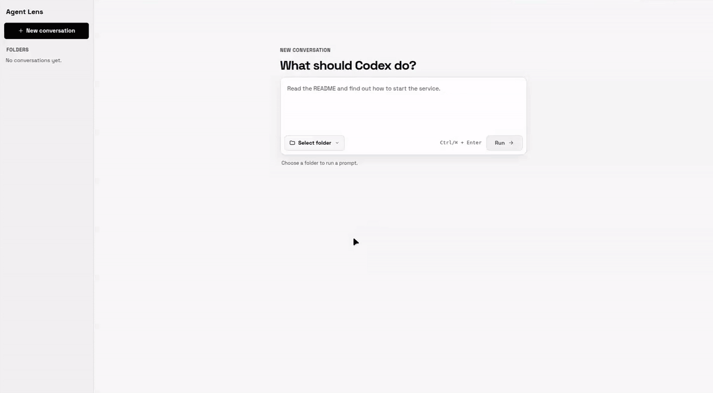

# Agent Lens

Agent Lens is a local web interface for watching a coding agent work. Choose a folder, send a prompt and follow what Codex does as it happens: messages, shell commands, file changes, failures and subagents.



- **Live trajectory** of each turn, with command output and exit codes.
- **Failures and unconfirmed results** kept visible, separate from the turn's own outcome.
- **Subagents** shown as branches of the turn that started them.
- **Reconnection** to a running turn, and follow-up prompts in the same Codex thread.
- **Token usage** reported by Codex and **durations** measured locally.

## Try it without an API key

```sh
docker compose -f compose.demo.yaml up --build --wait
```

Open [localhost:8081](http://localhost:8081/) and pick a conversation from the history. The demo shows fictional recorded turns with a failed test, file changes and a subagent. It runs no model and no commands, mounts none of your folders and has prompts disabled. Set `AGENT_LENS_DEMO_PORT` to use another port.

```sh
docker compose -f compose.demo.yaml down
```

## Run it with Codex

You need Docker with the Compose plugin and an OpenAI API key with access to the model.

```sh
cp .env.example .env
```

Set `CODEX_API_KEY` in `.env`, then start everything:

```sh
docker compose up --build --wait
```

Open [localhost:8080](http://localhost:8080/), use **Select folder**, send a prompt and open **View trajectory** on the turn. The first build downloads the official Codex release, about 200 MB, and checks its SHA-256.

```sh
docker compose down
```

Conversations are kept in Docker volumes.

### Choose what the agent can reach

One folder of your machine is mounted: [`workspace/`](workspace/) by default. To work on your own projects, set their parent folder in `.env` and start the app again:

```sh
AGENT_LENS_WORKSPACE=/absolute/path/to/your/projects
```

**Select folder** lists its subfolders, and each conversation keeps the one you chose. **The agent can modify the files in that folder.** Do not choose a folder that holds your `.env` or other secrets, including this repository.

On Linux, if `id -u` or `id -g` is not `1000`, set `AGENT_LENS_UID` and `AGENT_LENS_GID` in `.env` before the first start, so the agent can edit your files.

The agent's commands have no network access and can use `git`, `rg` and Python 3 (as `python` or `python3`). To give it other tools, add them to [`Dockerfile.executor`](apps/api-lens/Dockerfile.executor).

## Architecture


| Part | Responsibility | Boundary |
|---|---|---|
| Browser | Builds the trajectory from the events | Starts a conversation with a folder selection ID, not a host path |
| Nginx | Serves the interface and proxies the API | Refuses unknown `Host` names |
| API | Saves each capture and streams it | Has neither the API key nor the mounted folder |
| Executor | Drives Codex and validates the folder | Publishes no port |
| Codex | Calls the model and runs commands | Commands get no network |

A turn runs like this: the browser sends the prompt, the API creates a capture and calls the executor, and the executor starts or resumes a Codex thread. Each event is written and flushed to disk **before** it is sent to the browser.

## Engineering notes

**One event format, saved first.** The executor [translates App Server notifications](apps/api-lens/src/infrastructure/app_server.py) into the capture's own event format, leaving out the ones the trajectory does not use, such as the echo of the prompt. The API appends them to a JSONL file. The interface correlates updates by item ID, and live and saved turns go through the [same projection](apps/web/src/trajectoryProjection.js).

**A tool's result is not the turn's result.** A turn can complete after a command fails. A command that never reports its end is shown as **Result unconfirmed** instead of being counted as a success or a failure. See the [command timeline](apps/web/src/timeline.js).

**Disconnects do not stop the work.** The capture keeps recording if the browser goes away. The browser comes back with the ID of the last event it received and [reads from there](apps/api-lens/src/application/run_subscription.py). Integration tests cover [the disconnect](apps/api-lens/tests/integration/test_runs.py) and [the resume](apps/api-lens/tests/integration/test_run_history.py).

**Follow-ups stay on one thread.** A follow-up resumes the Codex thread of the latest run, and each run accepts [a single successor](apps/api-lens/src/infrastructure/capture_files.py), so two requests cannot fork a conversation. Token counts of a resumed turn exclude the earlier turns.

**Subagents arrive out of order.** A child's events can show up before the notification that links it to its parent. The executor [holds them briefly](apps/api-lens/src/infrastructure/app_server_delegation.py), within time, count and size limits, and marks a branch that never finished as an incomplete capture.

**Sandboxing inside Docker.** Codex isolates each command with Bubblewrap, which Docker's default profiles block: relaxing only seccomp or only AppArmor was not enough in testing. The executor service disables both, while dropping every Linux capability and running as a regular user. This is a real trade-off, described below.

**A local app is still reachable from the web.** Without a `Host` check, a malicious page could use DNS rebinding to talk to an API on your machine. Nginx and the API accept only local names, and [tests](apps/api-lens/tests/integration/test_local_access.py) cover prompts sent from other origins without a CORS preflight.

## Security and limitations

- The interface listens on loopback, accepts only the `localhost` and `127.0.0.1` host names and **has no authentication**. Do not expose it to a network.
- Codex runs each command in its own sandbox: no network, and access limited to the chosen folder and basic system paths.
- The **executor container runs with AppArmor and seccomp disabled**. It has no Linux capabilities, cannot gain privileges and runs as a regular user, but it is less isolated from your machine than a default container.
- The API key is passed to the executor as a Compose secret and masked if it appears in an event. A `.env` file keeps it in plain text on disk.
- Prompts, command output and captures are stored unencrypted. Review them before sharing screenshots or recordings.
- The executor handles one turn at a time. An event larger than 8 MiB ends the capture, keeping what was already saved.
- Tested on Linux x86_64 with kernel 5.15, Codex **0.171.0** and `gpt-6.2-sol`. macOS, Windows and ARM have not been tested. On Ubuntu 23.10 or later, the host may restrict the user namespaces the sandbox needs.

Set `AGENT_LENS_MODEL` to use another model. The [optional observability setup](observability/README.md) adds logs and traces.

## Planned

- Support for Claude Code.

## Development

Only needed to change the code. To run Agent Lens you need Docker, plus an API key for live runs.

<details>
<summary>Lint, type checks, tests and build</summary>

The checks make no model calls. They need `uv`, Python 3.13 and Node.js 24. Run them from the repository root.

```sh
uv run --directory apps/api-lens --locked ruff check .
uv run --directory apps/api-lens --locked mypy .
uv run --directory apps/api-lens --locked pytest -q
```

```sh
npm --prefix apps/web ci
npm --prefix apps/web test
npm --prefix apps/web run build
```

</details>
